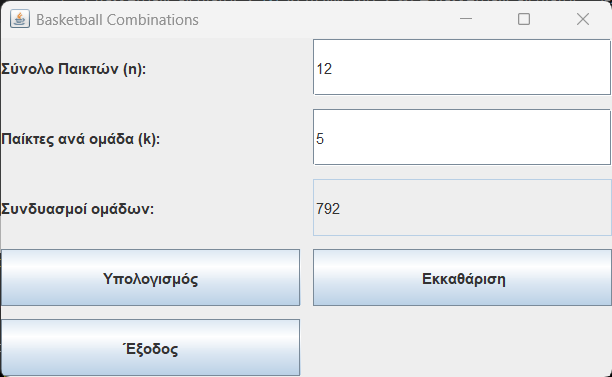

# BasketballCalculator

BasketballCalculator calculates how many different teams of k players can be built from n available players. For example, a coach with 12 players can see how many different lineups they can put on the court.

## Screenshot



## Technologies

- Java
- Swing (graphical user interface)
- BlueJ (development environment)
- Launch4j (packaging the .jar into a Windows .exe)

## How to run

### Option 1: Download (Windows)

Download `BasketballCalculator.exe` from the [Releases](https://github.com/SimosMantzios/BasketballCalculator/releases) page and double-click it. Requires Java to be installed.

### Option 2: Run from source (any OS)

Requires the Java Development Kit (JDK).

```bash
git clone https://github.com/SimosMantzios/BasketballCalculator.git
cd BasketballCalculator
javac BasketballCalculator.java
java BasketballCalculator
```

## What I learned

While testing, I found that n = 21, k = 1 returned **-1** instead of 21. The original code calculated the full factorial n!, and 21! is larger than the maximum value of a Java `long` (about 9.2 × 10¹⁸), so the value silently overflowed.

I fixed it by simplifying the formula: instead of computing n!, the program multiplies only the k terms n · (n−1) · … · (n−k+1) and then divides by k!. This gives the same result while keeping the numbers much smaller.

I verified the fix with the case that failed (21, 1 → 21) and re-tested a case that already worked (6, 3 → 20) to make sure nothing else broke.